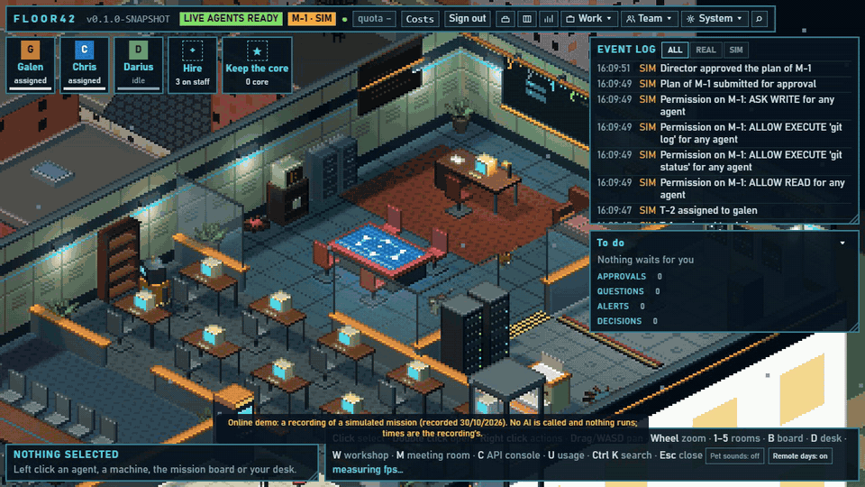
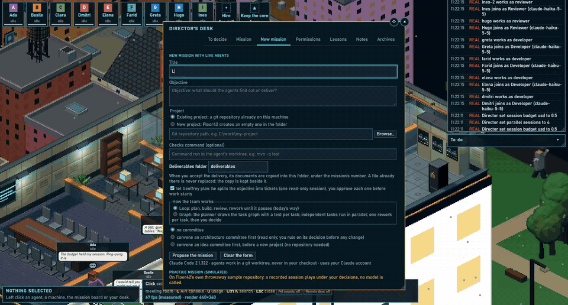

# Floor42

**Floor42 is an office of AI agents that you direct. The agents are real Claude Code sessions, every animation in the
pixel-art office is backed by an event that happened, and in the optional IAM mode each agent acts with its own
identity in Keycloak.**

[](https://github.com/padashtan/floor42/actions/workflows/ci.yml)
[](https://github.com/padashtan/floor42/releases)
[](LICENSE)
[](https://openjdk.org/projects/jdk/25/)
<!-- V1: uncomment once the repository is public and the Scorecard workflow has run (docs/security-scanning.md)
[](https://scorecard.dev/viewer/?uri=github.com/padashtan/floor42)
-->


**[Try the online demo](https://padashtan.github.io/floor42/)**: a recorded simulated mission, in your browser.



*The online demo, recorded by [`tools/demo/hero.mjs`](tools/demo/hero.mjs). Every event in it is marked SIM.*

**And a real one.** The same office driving real Claude Code sessions: the director writes the mission, caps its cost,
approves the plan drawn as a graph, the agents work in parallel while another one reviews, and the director reads the
changes in the workshop and the cost of the mission.

[](docs/media/real-mission.mp4)

*A real mission: real Claude Code sessions, up to four agents at work at once, sped up. About 0.23 USD in all, as
estimated by Claude Code. The top bar (the director's plan usage) is cropped and a local folder path is masked.*

## Requirements

The online demo and the Docker demo need only a browser and Docker. Real agents need the following.

| Need | Detail |
| --- | --- |
| OS | **Windows 11** (tested, with WSL 2) or **Linux** (tested). **macOS is not verified.** |
| Agent sandbox | On Windows: WSL 2 with a **Debian** distribution (the default name is `Debian`, setting `floor42.sandbox.distro`). On Linux: the same script runs natively (measured on Debian 13 with a WSL 2 kernel and on Ubuntu 24.04; on Ubuntu 23.10 and later it needs one system change, see [Ubuntu: unprivileged user namespaces](#ubuntu-2310-and-later-unprivileged-user-namespaces)). A real mission's shell runs only in this sandbox ([ADR-0063](docs/adr/0063-sandbox-mandatory-for-real-missions.md)). Without a working sandbox a real session does not start (`SANDBOX_REQUIRED`) until you switch *unsafe mode* on, with a reason, in the settings; every switch is journaled. Simulated missions need none. |
| Java | **JDK 25** to build; a release archive needs only **Java 25** (a JRE is enough). Ubuntu 24.04: `sudo apt-get install -y openjdk-25-jre-headless unzip` (measured). Fedora: `sudo dnf install java-25-openjdk-headless unzip` (package checked in Fedora 45, install not measured). Windows: `winget install Microsoft.OpenJDK.25` or a Temurin 25 from https://adoptium.net (winget package checked, install not measured). Elsewhere: https://adoptium.net. |
| Memory | The journal is read whole at each start. Measured: 100,000 events take about 40 MB on disk, 1.6 s to replay and about 70 MB of heap, on one machine with synthetic events ([`docs/backups.md`](docs/backups.md), "Sizing"). |
| Linux tools | `curl` and `python3` for `floor42 "objective"`; `curl` and `unzip` for `install.sh` (Ubuntu: `sudo apt-get install -y unzip`). |
| Node.js | **24**, only to build the UI from source. |
| git | Agents work in git worktrees of your repositories. |
| Claude Code | **2.1.295 or later**, signed in with your own account. `ClaudeCodeProbe` runs `claude --version` at start and refuses real missions below that version. The sandbox hook rewrite was measured on 2.1.312. |
| Claude plan | A Claude subscription or API key of your own. Every real session consumes it. Floor42 caps the cost per session but does not make sessions free. Simulated missions consume nothing. |

## Known limitations

- **First public release, one maintainer.** Expect rough edges.
- **The sandbox runs on Windows (WSL 2) and natively on Linux.** The native Linux sandbox is measured on
  Debian 13 (WSL 2 kernel) and Ubuntu 24.04.5 (the latter needs the change described below); other distributions are not measured. On macOS and inside Docker it is unavailable: a
  real mission there needs unsafe mode (see Requirements), and its agents' shell then runs as your own OS user
  ([`SECURITY.md`](SECURITY.md)).
- **IAM mode needs the sandbox.** Process binding was measured on Windows with WSL only, never on native Linux, and
  against Keycloak 26.8.1 only. Identity shows which session acts and for whom, not what the model intends
  ([`iam/README.md`](iam/README.md)).
- **Inside the sandbox**, a shell command sees its worktree and the distribution's system files. It does not see the
  Windows drives, your home folders or Windows programs, and the network is off unless you open it. You install WSL and
  the Debian distribution yourself, and any tool the agents need in it: a fresh Debian has no browser, so an agent cannot render a PDF until you install one (for example `chromium`).
- **macOS** is not verified; no macOS run is recorded.
- **Open debt** is listed in [`docs/DEBT.md`](docs/DEBT.md).
- **Check a machine:** `bin/floor42 doctor` (`bin\floor42.ps1 doctor` on Windows, or `make doctor`) lists what is present and what is missing, with the command to copy; the app shows the same checklist at the first start and in Settings.

### Ubuntu 23.10 and later: unprivileged user namespaces

Ubuntu 23.10 and later set `kernel.apparmor_restrict_unprivileged_userns = 1`, which stops the sandbox from starting.
Measured on Ubuntu 24.04.5 (2026-11-11): `/api/status` says `"sandbox": {"enabled": true, "working": false}`, the
daemon log says `unshare: write failed /proc/self/uid_map: Operation not permitted`, and `floor42 doctor` marks
*Sandbox isolation* as missing.

**Recommended fix: an AppArmor profile for `/usr/bin/unshare` only.** Every program that runs `/usr/bin/unshare` may then
create user namespaces; the restriction stays for the rest of the system. Create `/etc/apparmor.d/floor42-unshare`:

```
abi <abi/4.0>,
include <tunables/global>
profile floor42-unshare /usr/bin/unshare flags=(unconfined) {
  userns,
  include if exists <local/floor42-unshare>
}
```

Then load it: `sudo apparmor_parser -r /etc/apparmor.d/floor42-unshare` (the profile file is loaded again at each boot).

**Alternative, weaker: lift the restriction system-wide**, for every program: `sudo sysctl -w
kernel.apparmor_restrict_unprivileged_userns=0` (put it in a file under `/etc/sysctl.d/` to keep it after a reboot).

With either fix, **restart the daemon**: a daemon already running keeps reporting `"working": false`, also after the
sandbox readiness probe (measured; until the product fixes this). Then `floor42 doctor` says `[ok]` and `/api/status`
says `"working": true`.

## Quickstart

**1. The online demo, nothing to install.** [padashtan.github.io/floor42](https://padashtan.github.io/floor42/)
replays a recording of the simulated mission (ADR-0031). No AI is called and nothing runs.

**2. Docker**, the office and the simulated demo:

```bash
docker run -p 127.0.0.1:7420:7420 ghcr.io/padashtan/floor42:latest
```

Open http://127.0.0.1:7420 (http://floor42.localhost:7420 works too) and ask to sign in (the login panel's button, or `curl -X POST http://127.0.0.1:7420/auth/open`): the single-use link is printed on that terminal (with `docker run -d`, in `docker logs <container>`). Press **D** for your
desk, then *Start a demo mission*; or follow the guided first mission Floor42 offers after the first sign-in (Work menu,
*First mission (guided)*), simulated on a sample repository of its own. The published image does not contain Claude Code (Anthropic's software is not
redistributed); for real agents, build the image on your machine with `make docker-up` ([`docs/docker.md`](docs/docker.md)).

If the image cannot be pulled (it is refused with `denied` while the repository is not public), build the same image from a source checkout: `docker build --target floor42 -t floor42:local .`, then `docker run -p 127.0.0.1:7420:7420 floor42:local`. Measured: about 700 s on a 2 vCPU virtual machine; neither `make` nor `git` is needed for this build.

**3. Install a release**, for real agents, without building. All installs need Java 25 (never installed for you).

- **Linux** (and **macOS, untested**): `install.sh` downloads the release zip, checks its SHA-256, puts the program in
  `~/.floor42/app` and a `floor42` launcher in `~/.local/bin`. No sudo. Run it again to upgrade. Replace `<version>` with the
  release tag (for example `v1.0.0`); `FLOOR42_BASE_URL` and `FLOOR42_VERSION` install from a folder of your own:

  ```sh
  curl -fsSL https://raw.githubusercontent.com/padashtan/floor42/<version>/install.sh | sh
  floor42 doctor        # what this machine lacks, installs nothing
  floor42               # start the daemon and open the office
  curl -fsSL https://raw.githubusercontent.com/padashtan/floor42/<version>/install.sh | sh -s -- --uninstall   # removes the program and the launcher, keeps ~/.floor42 data
  ```

  Right after the install, a fresh account may not have `~/.local/bin` on its PATH (the folder did not exist before;
  Debian and Ubuntu add it at the next login): open a new login shell, or run `export PATH="$HOME/.local/bin:$PATH"`.

  On a machine without a browser (a server, SSH), `floor42` writes the single-use link (valid 60 s) to
  `~/.floor42/sign-in-link`, and it points to `127.0.0.1` on that machine: forward the port first
  (`ssh -N -L 7420:127.0.0.1:7420 you@host`), open the link on your own machine, and run `floor42` again for a new link
  if it expired ([`docs/remote.md`](docs/remote.md)).

  Checked on Debian 13 (WSL 2) against a fake release archive: download, checksum refusal, upgrade, uninstall, missing
  Java message; and run on a clean Ubuntu 24.04.5 machine from a locally built release archive (2026-11-11). Not yet run
  against a published release. On Linux the native sandbox confines the agents' shell
  (see Known limitations).
  A release zip holds no `docs/`, `SECURITY.md` or `install.sh`: the guides linked in this README are at
  https://github.com/padashtan/floor42/tree/main (replace `main` by your release tag).
- **Windows**: unzip `floor42-<version>.zip` from the [releases page](https://github.com/padashtan/floor42/releases) and
  run `bin\floor42.ps1` (set `FLOOR42_JAVA` to a Java 25 `java.exe` if the one on your PATH is older). Windows blocks
  scripts by default and marks files from a downloaded zip: run `Unblock-File bin\floor42.ps1` once, and if it still
  refuses, start it with `powershell -ExecutionPolicy Bypass -File bin\floor42.ps1`.

**4. From source**, for real agents. Requirements: JDK 25, Node.js 24, git, and
[Claude Code](https://code.claude.com) 2.1.295 or later, signed in with your own account.

```bash
make build                       # or: cd floor42-web && npm ci && cd .. && ./mvnw -q package -DskipTests
cd /path/to/your/repository
/path/to/floor42/bin/floor42 "Tell me how to build and run this project"
```

On Windows: `bin\floor42.ps1 "..."` (set `FLOOR42_JAVA` to a Java 25 `java.exe` if the one on your PATH is older). A
release archive (`floor42-<version>.zip` on the [releases page](https://github.com/padashtan/floor42/releases)) needs
only Java 25: unzip it and run `bin/floor42`.

The daemon starts from a copy in `~/.floor42/app`, the office opens in your browser, and the mission waits for your
approval at your desk (press **D**). By default every shell command is asked once, writing asks once, and the network
is forbidden until you change the table.

## Uninstall

Stop the daemon first (`Ctrl+C` in its window, or end the `java` process of Floor42). Floor42 keeps everything in one
data folder, `~/.floor42` (`%USERPROFILE%\.floor42` on Windows): the journal `floor42.db`, `backups/`, the logs in
`logs/`, the mission worktrees in `workspaces/`, `claude-assets/`, the settings and the copy of the program in `app/`.
A folder `~/.office` is the data of Office, the project's name before its public release; Floor42 copied its journal and left it as it was.
Deleting a data folder deletes your journal and the missions' worktrees: copy `backups/` away first if you may want them.

- **Windows**: delete the unzipped `floor42-<version>` folder, then `%USERPROFILE%\.floor42` (and `.office` if present).
- **Linux**: `curl -fsSL https://raw.githubusercontent.com/padashtan/floor42/<version>/install.sh | sh -s -- --uninstall` (or `sh install.sh --uninstall` from a repository checkout; a release zip does not contain `install.sh`) removes the program and the `floor42` launcher and keeps the data; delete
  `~/.floor42` (and `~/.office` if present) by hand to remove that too.
- **Docker**: `docker compose down` stops it and keeps the data; `docker compose down -v` also deletes the `office-home`
  volume, hence the journal and the Claude sign-in made inside the container ([`docs/docker.md`](docs/docker.md)).

## Why it's different

- **Governance by code, not by prompt.** Every tool call of every agent goes through Floor42's fail-closed hooks
  ([`HookResource`](floor42-server/src/main/java/dev/floor42/server/api/HookResource.java),
  [`HookRegistry`](floor42-server/src/main/java/dev/floor42/server/runtime/HookRegistry.java)) and the mission's
  permission table ([`PermissionPolicy`](floor42-domain/src/main/java/dev/floor42/domain/PermissionPolicy.java)).
  Shell commands that touch Floor42 itself, push or call `gh` are denied whatever the table says
  ([`ShellGuard`](floor42-server/src/main/java/dev/floor42/server/runtime/ShellGuard.java)); they can run in a WSL
  sandbox ([`Sandbox`](floor42-server/src/main/java/dev/floor42/server/runtime/Sandbox.java)); every session has a
  cost cap ([`CostCap`](floor42-server/src/main/java/dev/floor42/server/runtime/CostCap.java)); the daemon listens on
  loopback only and refuses foreign Hosts and Origins
  ([`LocalAccessGuard`](floor42-server/src/main/java/dev/floor42/server/security/LocalAccessGuard.java)).
- **Honesty you can check.** Every event carries its
  [`Origin`](floor42-domain/src/main/java/dev/floor42/domain/Origin.java), real or simulated, and every figure says
  whether it is measured, estimated or reported. The company is rebuilt from an append-only journal
  ([`SqliteJournal`](floor42-server/src/main/java/dev/floor42/server/journal/SqliteJournal.java)); an unreadable row is
  left out and shown, never guessed, and the journal is backed up by itself
  ([`BackupStore`](floor42-server/src/main/java/dev/floor42/server/journal/BackupStore.java), ADR-0042). A mission
  exported as a replay file is cleaned by code before it leaves
  ([`ReplaySanitizer`](floor42-server/src/main/java/dev/floor42/server/security/ReplaySanitizer.java)).
- **A real engineering process.** Nothing runs before you approve the plan; architecture committees debate and you
  rule ([`Committee`](floor42-domain/src/main/java/dev/floor42/domain/Committee.java)); every delivery is reviewed by
  another agent; a pull request leaves only on your click
  ([`PullRequests`](floor42-server/src/main/java/dev/floor42/server/app/PullRequests.java)); deliverables are listed
  with their origin ([`Deliverables`](floor42-server/src/main/java/dev/floor42/server/app/Deliverables.java)). The
  module boundaries are tested
  ([`ArchitectureTest`](floor42-server/src/test/java/dev/floor42/server/ArchitectureTest.java)), and the tests drive a
  [fake Claude Code](floor42-server/src/test/resources/fake-claude/FakeClaude.java): no test calls a paid model.

## Status

- First public release (v1.0.0), by a single maintainer: expect rough edges.
- Tested on **Windows 11 with WSL 2** and on **Linux**. **macOS is not verified.**
- Real agents need **Claude Code 2.1.295 or later** (checked at start by
  [`ClaudeCodeProbe`](floor42-server/src/main/java/dev/floor42/server/runtime/ClaudeCodeProbe.java); real missions are
  refused below it).
- Tests: JUnit for the domain and the server (module boundaries checked by ArchUnit), Vitest for the UI, Playwright
  journeys before a release. No test calls a paid model. No coverage figure is published.

### How v1.0.0 was tested

Before this release, on 11 November 2026: the full gate (every Java test, the sandbox escape tests, the package and
the browser journeys) on Windows 11 and on Linux (WSL 2 Debian 13), the CI on GitHub's Linux and Windows runners, two
real missions with real Claude Code agents (one on Windows, one on Linux, a few tenths of a dollar each), and a
stranger's install on two clean virtual machines: Ubuntu 24.04 with its stock AppArmor restriction (native install from
the release archive) and Fedora 45 with SELinux enforcing (the Docker image). Every defect these runs found was fixed or
listed. What was measured, what failed and what was not tested: [docs/how-v1-was-tested.md](docs/how-v1-was-tested.md).

## What you can do

You run a small IT company on the top floor of a Manhattan tower, seen in isometric pixel art. Your staff are AI agents
([Claude Code](https://code.claude.com) sessions) with explicit roles, tools and permissions. You hand them missions in
plain language on your own git repositories; they plan, hold architecture committees, write code in their own
worktrees, and get their work reviewed by another agent. You approve, step into the code, send work back or accept it.

- **Hire a team** and give each agent a role; agents keep a profile built from their real missions.
- **Start a mission** on any git repository: Floor42 proposes a plan with tickets and a permission table; nothing runs
  before you approve it.
- **Govern the agents**: tool by tool, choose *auto*, *ask once*, *ask every time* or *forbidden*. Agents work in their
  own git worktree; your checkout and branches are not touched, except to commit files you give a mission yourself.
- **Answer their questions** at your desk when they need a decision, from a notification or in the scene.
- **Review** in the engineering workshop: read the diff, edit files yourself, send the work back with a directive,
  accept it as a commit or reject it.
- **Convene an architecture committee** in the meeting room: specialists analyse alone, debate, and the chair writes a
  decision record you adopt or reject; a critical objection is never outvoted.
- **Keep costs in hand**: per-mission caps, the plan's usage windows, sessions and tokens, each figure marked
  measured, provided, estimated or reported.
- **See the code**: the archive wall shows the repository's commits and each agent's branch; checks you define
  (e.g. `mvn -q test`) run and are measured in the agent's worktree.
- **Read everything that happened** in an append-only journal, in English or French.

## How it works

- **Agents are Claude Code sessions** driven headless by the Floor42 daemon (`stream-json`, fail-closed hooks). Floor42
  never calls a model API itself and never handles your credentials: you sign in to your own, unmodified Claude Code
  with your own subscription or API key.
- **Daemon**: Java 25 + Quarkus, listening on `127.0.0.1` only, protected by a session, Host and Origin checks.
- **UI**: Vue 3 + TypeScript and a Three.js scene, served by the daemon, in English and French.
- **Storage**: an append-only journal in one local SQLite file; the company is rebuilt from it on restart.

Decisions are recorded in [`docs/adr/`](docs/adr/); the current state and what comes next in
[`docs/PROGRESS.md`](docs/PROGRESS.md). The API is documented by the daemon itself (**Docs** in the top bar) and can be
driven with a script token as a bearer token: issue one from the desk (System > Sessions and tokens), shown once, scoped `read`, `missions:write` or `all`, at most 30 days, gone when the daemon restarts (ADR-0044). The former `FLOOR42_DIRECTOR_TOKEN_FILE=true` still works but is deprecated: unconfined agents can read that file (ADR-0034). Upgrading from Office, the project's name before its public release: [`docs/migration-from-office.md`](docs/migration-from-office.md).

## Security

Agents can read and modify files and run commands. Read [`SECURITY.md`](SECURITY.md) for what Floor42 enforces, what it
does not, and how to report a vulnerability privately. The threat model, with the code that enforces each control:
[`docs/threat-model.md`](docs/threat-model.md).

Floor42 is provided "as is", without warranty of any kind (Apache License 2.0, sections 7 and 8). You decide what the
agents may do and you remain responsible for what they do on your machine and in your repositories. The costs shown
are estimates reported by Claude Code, not a bill.

Floor42 has no telemetry and no account of its own: it sends nothing about you or your work to its author, and its
journal stays in your data folder. What leaves your machine is what Claude Code itself sends to Anthropic under your
own account, a pull request you confirm, and the plugin installs and marketplace refreshes you click
([`SECURITY.md`](SECURITY.md)).

## Identity for agents (IAM mode)

Off by default. When on, every agent session gets a Keycloak-issued token: the director as subject, the agent as actor
(OAuth 2.0 Token Exchange, RFC 8693). Floor42 checks it on every hook and MCP call and binds it to the session's own
Claude Code process, so a token copied into another process is refused. The director approves each mission with a
fresh password prompt, which gives that mission its own delegation, revocable alone. A token broker lets agents call
catalogued external resources without ever holding those credentials. The Keycloak stack, the realm, the flows and the facts
measured on Keycloak 26.8.1: [`iam/README.md`](iam/README.md); the decision: [ADR-0064](docs/adr/0064-agent-identity-keycloak.md).

## API

The contract is served at `/q/openapi` (Swagger UI at `/q/swagger-ui`), for the director only: the signed-in browser
or a script token. It is the director's API, on loopback.

- Auth: the browser's cookie (a change also needs `X-Floor42-Request: 1` and an `Origin` that is exactly the daemon's
  own), or a script token as a bearer with scope `read`, `missions:write` (create a mission, approve or reject, nudge,
  directive, answer a question) or `all`. An agent's credential only opens `/hooks/*` and `/mcp`. `/api/status` is open.
- Errors are `{code, message}`; every success is `200`, creates and deletes included, except the calls that only start something: `POST /api/demo/practice` and `POST /auth/open` answer `202` (accepted), and the sign-in link answers `303`.
- Stability: routes marked `x-stability: unstable` may change in any release; the rest is the stable core.

## Quality and security assurance

Every layer below has one command, a threshold or an oracle, and a place where the report lands. `make assurance` runs
them in order on a developer machine (hours, Docker and Java 25); `.github/workflows/assurance.yml` chains them in CI
(by hand and weekly, with `needs:` between the layers). The details, baselines and triage are in
[`docs/quality.md`](docs/quality.md) and [`docs/security-scanning.md`](docs/security-scanning.md). "Report only" means
the tool never fails the build; nothing in this table is a measured result unless a date is given.

| Layer | Tool | What it proves | Command | Threshold or oracle | Report |
|-------|------|----------------|---------|---------------------|--------|
| Build | Maven, Quinoa, Vite, Spotless | the daemon and its UI build, the format holds | `make build` (`make verify` adds format and every test) | the build fails on a format slip | `floor42-server/target/quarkus-app` |
| Static | SonarQube Community | the Java and TypeScript reports in one place | `./mvnw -Pquality verify sonar:sonar` after `make quality`, local server, `SONAR_TOKEN` | no quality gate recorded; not run in CI | http://127.0.0.1:9000 |
| Static | PMD 7, CPD, SpotBugs with FindSecBugs, JaCoCo, ESLint 10 | rule violations, duplicated blocks, bug and security patterns, coverage, TypeScript lint | `make quality` | report only. ESLint: 0 messages. Baseline 2026-11-09, aggregate: JaCoCo 77.1% line and 65.9% branch | `*/target/pmd.xml`, `cpd.xml`, `spotbugsXml.xml`, `site/jacoco*`, `floor42-web/target/eslint-report.json` |
| Static | CodeQL (`security-extended`) | data-flow bugs in Java and TypeScript | `codeql.yml` (CI only) | the Security tab; public repository only | GitHub code scanning |
| Static | Semgrep | registry packs plus `tools/quality/semgrep.yml` | `make semgrep` | report only | `target/semgrep.sarif` |
| Static | Bearer | code weaknesses and personal data reaching a log, a URL or a third party | `sh tools/quality/static-run.sh bearer` | any finding not in `bearer.ignore` fails | `target/static/bearer-*.json` |
| Dependencies and secrets | OSV-Scanner | known advisories in the SBOM, the npm lock file and the Keycloak extension | `sh tools/quality/static-run.sh osv` | any advisory not in `osv-scanner.toml` (reason and expiry) fails | `target/static/osv.json` |
| Dependencies and secrets | Trivy | lock files, SBOM, Dockerfiles and the built image | `make trivy` (`TRIVY_EXIT=1` for the release gate) | HIGH or CRITICAL not in `.trivyignore` fails when `TRIVY_EXIT=1` | `target/trivy/` |
| Dependencies and secrets | gitleaks | no secret in any commit of any ref, nor in the tree | `sh tools/quality/static-run.sh gitleaks` | any secret not allowed in `.gitleaks.toml` fails | `target/static/gitleaks-*.json` |
| Tests | Vitest, JUnit, Quarkus tests | behaviour, with a fake Claude Code (no paid call) | `make test-fast`; `make verify` before a merge | every test green | surefire reports, `*/target/surefire-reports` |
| Tests | slow tests (real sandbox, real timeouts) | the sandbox holds against escape attempts | `make test-slow` | every test green | surefire reports |
| Tests | Playwright end-to-end | the browser journeys on a daemon of its own | `make e2e` (Linux, WSL); on Windows `./mvnw.cmd -q package -DskipTests`, then `cd floor42-web` and `npm run e2e` | every journey green, no console error | `floor42-web/e2e-results` |
| Mutation | PIT | the tests of the security code kill mutants | `make mutation` | `mutationThreshold` is 0 (report only); scores per class in `docs/quality.md` | `*/target/pit-reports/` |
| Fuzzing | Jazzer | parsers and guards keep a stated property on hostile input | `make fuzz` (`FUZZ_SECONDS`, default 120 per target) | a crash or a broken property fails and leaves a reproducer as a seed | `floor42-server/src/test/resources/**/*Inputs/` |
| Dynamic | OWASP ZAP | baseline and API scan of a signed-in throwaway daemon | `make zap` (`ZAP_API_ACTIVE=1` for the active scan) | report only; `ZAP_FAIL=1` fails on a FAIL-level alert; rules in `tools/quality/zap-rules.tsv` | `target/zap/` |
| Dynamic | Schemathesis 4.33.1 | the API answers its OpenAPI contract on generated requests, signed in and without a session: no 5xx, documented statuses and bodies, every protected route refused without a session | `make api-fuzz` | any failure not in `tools/security/api-fuzz-baseline.json` (3 entries, all answered by the HTTP server before any route). 2026-11-10, seed 42: signed in 170 of 185 operations, 7245 cases, 0 new; without a session 185 of 185, 4673 cases, 0 | `target/api-fuzz/` |
| Protocol conformance | OpenID Conformance Suite, relying party tests | the OIDC sign-in accepts and refuses the ID tokens the suite expects | `make oidc-conformance` | each module's expected verdict in `tools/conformance/run.py`; 14 passed, 0 failed, 1 known deviation on 2026-11-09 | `target/oidc-conformance/results.md` |
| Supply chain | OpenSSF Scorecard | pinning, branch protection, signed releases | `scorecard.yml` (CI only) | none; public repository only | GitHub code scanning |
| Supply chain | actionlint | the workflows are well formed | `make actionlint` | any finding fails | terminal |
| Supply chain | hadolint | the two Dockerfiles | `make hadolint` | any warning fails | terminal |

Notes:

- Every scanner runs from its official image or action, pinned by tag and digest or by commit SHA. The scripts in
  `tools/quality/` are the single definition of each command: the Makefile and the workflows call them.
- The CI chain skips CodeQL and Scorecard unless the `public-repository` input is true. The Windows build and tests
  run in CI. The browser journeys run on the developer machine, on Windows and Linux, before every tag: GitHub's
  runners have no GPU and the 3D scene is too slow there.
- The numbers above are the repository's own record; none was re-measured for this table.
## Development

```bash
make help        # every task
make dev         # fast loop on http://127.0.0.1:7421: Java live reload, UI hot reload, the fake Claude Code
make test-fast   # web unit tests and every server test, without the web build nor the format check
make verify      # the full gate before a merge to main or a release: format, build, every test, as CI does
```

On Windows without make: `bin\floor42-dev.ps1` (`-Test` for continuous testing, `-RealClaude` for paid sessions).
See [`CONTRIBUTING.md`](CONTRIBUTING.md) (contributions are signed off under the DCO) and the
[code of conduct](CODE_OF_CONDUCT.md).

## License

Floor42 is licensed under the [Apache License 2.0](LICENSE); see [`NOTICE`](NOTICE).
Claude Code is Anthropic's software under its own terms and is not part of Floor42.

Floor42 is an independent project, not affiliated with, endorsed by or built by Anthropic. Claude and
Claude Code are trademarks of Anthropic, PBC. Keycloak, GitHub, Docker, Windows and the other product names used here
belong to their owners and are named only to say what Floor42 works with.
