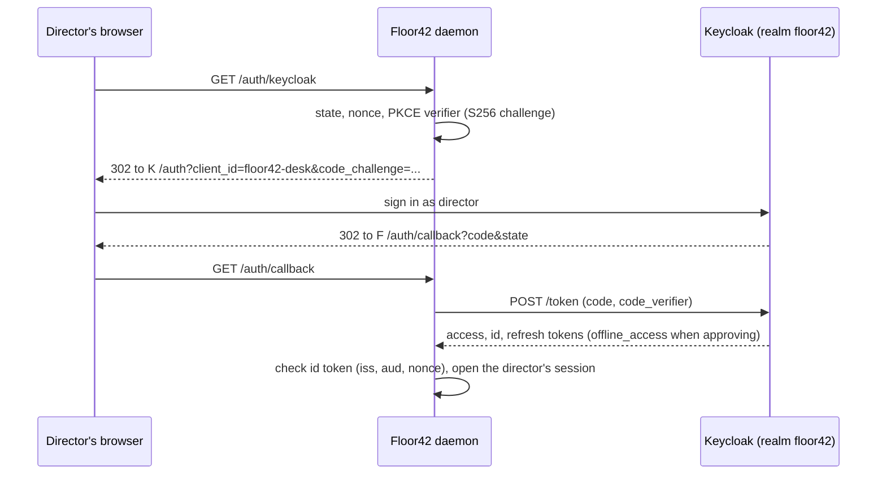
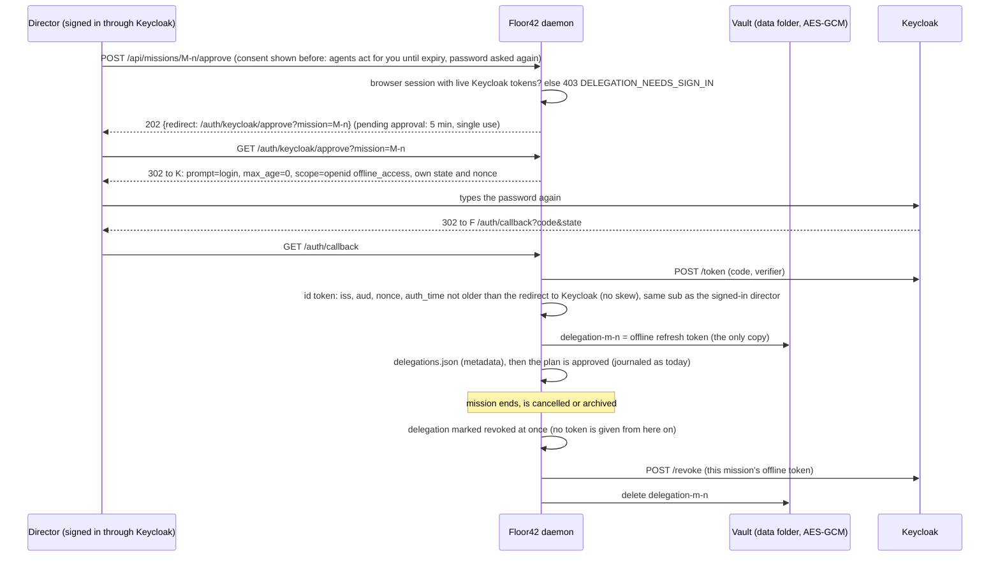
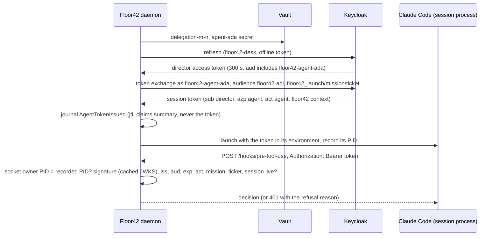
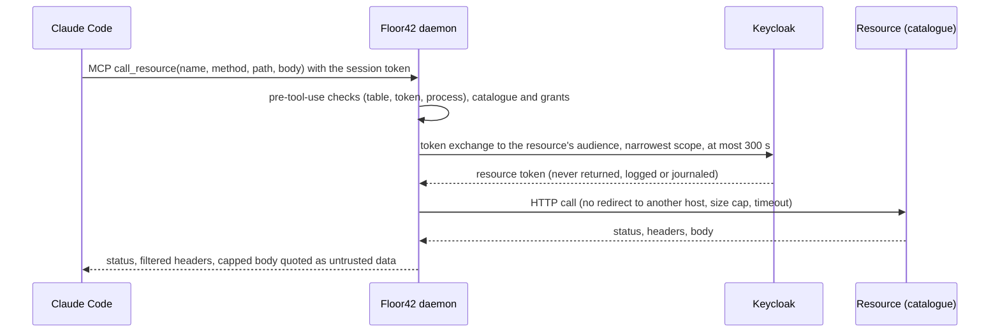

# Floor42 IAM mode: agents with a Keycloak identity

In IAM mode every Claude Code session that Floor42 launches calls the daemon with a token issued by Keycloak: the
director is the subject, the agent is the actor (OAuth 2.0 Token Exchange, RFC 8693), and the token is checked on
every hook and MCP call, bound to the session's own process. IAM mode is opt-in; off, Floor42 behaves as before.

This folder holds a development Keycloak (26.8.1, standard token exchange V2) with its Postgres, the `floor42` realm,
the bootstrap script and the source of the Floor42 protocol mappers (`keycloak-extensions/`), which you build into a jar.

## The model

| Who | In Keycloak | Proves |
|---|---|---|
| The director | user `director` of realm `floor42`, signs in through `floor42-desk` (Authorization Code + PKCE S256) | who delegates |
| An agent on staff | confidential client `floor42-agent-<agentId>` with a service account, created by Floor42 at hire | who acts (`azp`, `act`) |
| Floor42 | confidential client `floor42-daemon` (service account: `manage-clients`, `view-clients`, `query-clients`) | the attesting launcher: it alone holds the agent secrets and performs every exchange |
| The hook and MCP API | client `floor42-api`, no flow, the audience, and the introspection caller (confidential) | the token is for Floor42, not for anything else |

An AI agent holds no secret and cannot prove anything by itself: "the agent" is the Claude Code process Floor42
launched. Floor42 attests it, as SPIFFE does for workloads, and binds the token to that process.

## Run it

Needs Docker with Compose v2, `openssl` and `bash` (on Windows: from WSL).

```sh
iam/bootstrap.sh                       # first run: writes iam/.env (random secrets, mode 600), nothing else
docker compose -f iam/compose.yaml up -d
iam/bootstrap.sh                       # second run: keeps iam/.env, creates the user "director" (you type the password)
```

Keycloak listens on `http://localhost:8180` (loopback only), admin console `http://localhost:8180/admin` (user
`admin`, password `KC_BOOTSTRAP_ADMIN_PASSWORD` in `iam/.env`). Stop with `docker compose -f iam/compose.yaml down`;
add `-v` to drop the database volume as well.

**Dev only.** `iam/.env` is git-ignored and never committed. The realm file carries no secret: the daemon client's
secrets are the placeholders `${FLOOR42_DAEMON_SECRET}` and `${FLOOR42_API_SECRET}`, replaced by Keycloak at import from the container environment.
Secrets are hex (`openssl rand -hex 32`): Keycloak URL-decodes HTTP Basic client credentials, so a base64 secret with
`+`, `/` or `=` fails client authentication. On a Windows drive mounted in WSL (`/mnt/c`), `chmod 600` has no effect:
keep the checkout on the Linux side for real owner-only rights. `start-dev` is a development server (HTTP, no
hostname check); a production Keycloak needs `start`, TLS and a real hostname.

The image is the stock Keycloak plus the jars found in `iam/keycloak/providers/` (the Floor42 mappers built from
`iam/keycloak-extensions/`; the folder holds only `.gitkeep` until you build the jar). After adding a jar: `docker compose -f iam/compose.yaml build`.

## Turn it on

IAM mode is off by default and needs the WSL sandbox (`IAM_NEEDS_SANDBOX` otherwise). The settings are saved in
`<data-dir>/iam/settings.json` through `PUT /api/iam/settings` (`enabled`, `issuer`, `maxTokenHours`, and the
`daemonSecret` and `apiSecret` values from `iam/.env`, which go to the vault and are never returned). Turning it on or
off takes a restart. The properties `floor42.iam.enabled`, `floor42.iam.issuer` and `floor42.iam.max-token-hours`
override the file when set. `GET /api/iam/status` says whether IAM mode is running and why not.

## Check it yourself

```sh
docker compose -f iam/compose.yaml up -d
curl -s localhost:8180/realms/floor42/.well-known/openid-configuration | jq -r .issuer
# http://localhost:8180/realms/floor42
```

The realm is imported on the first start of a clean database (`--import-realm`, existing realm kept afterwards).

## The realm contract

- Realm `floor42`, issuer `http://localhost:8180/realms/floor42` (pinned by `KC_HOSTNAME`, whatever address the
  request used), access token lifespan 300 s, RS256.
- `floor42-desk`: public, standard flow, PKCE `S256` required, redirect URIs `http://127.0.0.1:7420/auth/callback`,
  `http://localhost:7420/auth/callback` and the same on 7421 (dev mode).
- `floor42-daemon`: confidential, service account with the three `realm-management` roles above, standard token
  exchange on.
- `floor42-api`: confidential (secret `${FLOOR42_API_SECRET}`), no flow, no service account: the audience of every
  agent session token and the only client that can introspect one (see the measurements below).
- Client scope `floor42-agent`: default scope of every agent client; puts `floor42-api` in the audience and
  holds the Floor42 mappers (`act`, the Floor42 session context).
- Agent clients `floor42-agent-<agentId>`, created by Floor42: confidential, service account on, standard token
  exchange on, `access.token.lifespan` = `max-token-hours * 3600` (at most 28800). The attribute
  `standard.token.exchange.enableRefreshRequestedTokenType` must stay absent (or `NO`) on agent clients: an agent must
  not get a refresh token from an exchange (`MappersIT` checks it; the daemon never sets it when it creates an agent client).
- The standard scopes (`basic`, `profile`, `email`, `roles`, `web-origins`, `acr`, `offline_access`,
  `service_account`) are spelled out in the realm file: a realm file that lists any client scope gets no built-in
  scope from Keycloak, and without `basic` a token has no `sub` (measured).

## What Keycloak 26.x does (spike, measured on 26.8.1, 2026-11-04)

Measured with `curl` against this stack: a director token from a test public client with direct grant (spike only,
not in the realm file), an agent client `floor42-agent-ada` created by `floor42-daemon` through the admin API (201:
the daemon's roles suffice), lifespan 28800. Each answer below is what Keycloak returned, not what its docs say.

1. **The requester must be in the subject token's `aud`.** Exchange by `floor42-agent-ada` of a director token whose
   `aud` is `account` only: `access_denied` "Client is not within the token audience". After an audience mapper
   `floor42-agent-ada` on the director's client, the same exchange succeeds. Consequence: when Floor42 creates an
   agent client it also adds an audience mapper for that client on `floor42-desk` (a protocol mapper on a
   client: `manage-clients` is enough). The requested `audience` must also be reachable by the requester:
   `audience=floor42-desk` gives "Requested audience not available"; `audience=floor42-api` works through the
   `floor42-agent` scope. With `audience=floor42-api` the token's `aud` is exactly `floor42-api`; without the
   parameter it is `["floor42-api","account"]`.
2. **Refresh tokens from an exchange: online only, never offline.**
   - `requested_token_type=...:refresh_token` with the default client config: "requested_token_type unsupported".
   - With the client attribute `standard.token.exchange.enableRefreshRequestedTokenType=SAME_SESSION`: a refresh token
     is returned, `typ` `Refresh`, bound to the director's online SSO session (`refresh_expires_in` 1800 = the SSO
     idle timeout); refreshing it works; after the director's sessions are logged out: "Session not active".
   - `scope=offline_access` in an exchange: "Scope offline_access not allowed for token exchange".
   - A subject token from an offline session with a requested refresh token: "Refresh token not valid as
     requested_token_type because creating a new session is needed".
   - `subject_token_type=...:refresh_token`: "Parameter 'subject_token' supports access tokens only".
   - `floor42-daemon` exchanging for `audience=floor42-agent-ada`: "Requested audience not available".

   **Decision: option (B).** The director signs in with `scope=openid offline_access`; Floor42 keeps the
   director's offline refresh token per mission, encrypted. For each session it refreshes it through `floor42-desk`
   (public client, no secret), gets a director access token (300 s, `aud` with the agent clients), and the agent
   client exchanges that for the session token. Measured: the offline refresh works after the director's online
   session is deleted; the exchange of an access token from the offline session succeeds; RFC 7009 `revoke` of the
   offline refresh token answers 200 and the next refresh gives "Offline user session not found". The admin "log out
   user" (`POST /users/{id}/logout`) also kills offline tokens ("Stale token"). Per-mission revocation needs one
   offline session per mission: one sign-in per approval.

   **Offline tokens of one SSO session share one offline session (measured 2026-11-04, spike).** `floor42-desk`
   gets `offline_access` as is (token response `scope` "openid email offline_access profile", refresh token `typ`
   `Offline`; no realm change needed). Two Authorization Code + PKCE flows inside ONE browser SSO session (the second
   silent, `prompt=none`) give offline tokens R1 and R2 with the same `sid` and different `jti`; both refresh. RFC 7009
   `revoke` of R1 answers 200, then R1 AND R2 both fail: "Offline user session not found". R2 does not survive, and
   the SSO session is gone too (a further `prompt=none` answers `login_required`). A second flow with `prompt=login`
   (password typed again) makes a new user session (different `sid`): revoking its token leaves the other one
   refreshing (200). So per-mission revocation in Keycloak needs one full re-authentication per approval, or a
   different model (one shared offline token, per-mission revocation enforced locally).
3. **`act` is not added by V2.** No `act` claim in any exchanged token: the `floor42-agent` mappers write it.
   The exchanged token keeps the director as `sub`, `azp` = the agent client, and Keycloak's own `sid` = the
   director's SSO session id. So Floor42's session id must not go in `sid` (it is taken): it goes in the
   `floor42.launch` claim. **Lifespan**: the requester client's `access.token.lifespan` applies (28800 s measured),
   not the subject token's 300 s and not the SSO idle timeout, both for online and offline subject tokens. The
   agent's own `client_credentials` token also carries `aud` `floor42-api` (the scope) with `sub` = its service
   account and no `act`: the verifier must require `act` and a `sub` that is a user, never accept that token.
4. **Form parameters at exchange time.** V2 accepts and ignores unknown form parameters (`floor42_mission=M-3`: 200,
   token unchanged). A protocol mapper does read them (see the mappers below; `MappersIT` checks it).
5. **Introspection.** Keycloak 26.8.1 answers `active: false` to any client that is not in the token's `aud`, even
   the token's own `azp` (measured with the agent client, `floor42-daemon` and a third client). An agent session token
   (`aud` `floor42-api`) is therefore introspectable only as `floor42-api`, which is confidential in the realm file:
   the 60 s check needs either `floor42-api` confidential with its own secret, or the admin API (client
   enabled, offline session present). Measured as `floor42-api` made confidential for the test:
   - agent client disabled: `active: false` at once; re-enabled: `true` again; exchange while disabled:
     `invalid_client`;
   - offline refresh token revoked: tokens exchanged from that offline session become `active: false`;
   - the director's online session deleted (admin `DELETE /sessions/{id}`): a token exchanged from it stayed
     `active: true`. Revocation must go through the agent client or the delegation, not the online session.
   - Introspection reports `aud` `["floor42-api","account"]` for a token whose own `aud` is `floor42-api`: trust the
     signed token, not the introspection echo, for claims.

### The Floor42 mappers (`keycloak-extensions/`)

Own Maven module (not in the root reactor). Build, then the image picks the jar up:

```sh
mvn -f iam/keycloak-extensions/pom.xml verify        # MappersIT needs Docker (skipped without)
cp iam/keycloak-extensions/target/floor42-keycloak-extensions.jar iam/keycloak/providers/
```

The realm file references `floor42-act-mapper` and `floor42-context-mapper` in the `floor42-agent` scope: build the jar
before the first `docker compose up`. Both act on the token-exchange grant only.

- `act = {sub, client_id}` comes from the client that authenticated the request (never a parameter); written only
  when that client is confidential and has a service account.
- `floor42 = {launch, mission, ticket}` is read from the form params `floor42_launch` (UUID), `floor42_mission`
  (`M-n`), `floor42_ticket` (`T-n`) (measured: a mapper reads them through
  `session.getContext().getHttpRequest().getDecodedFormParameters()`), only from that same confidential client, only
  when all three are valid.
- The `floor42` claim is a self-assertion by the authenticated agent client (it holds the secret and chooses the
  params); Floor42 binds it to its own session record.
- Only a token whose audience set is exactly `{floor42-api}` keeps the client lifespan; any other (other audience,
  several audiences, no `audience` param) expires within 300 s. Measured: the mapper sees every scope audience and
  Keycloak narrows `aud` to the requested `audience` params afterwards, so the requested params decide when present.
- The image build fails when the mapper jar is missing from `iam/keycloak/providers/`.

## Flows

### Director sign-in (Authorization Code + PKCE)



### Plan approval: per-mission delegation (password step-up)

Keycloak keeps every offline token of one SSO session in one offline session (measured, see above), so a mission's
delegation cannot be revoked alone unless it comes from its own login. Approving a plan therefore asks for the
password again; the normal sign-in asks only `scope=openid` and holds no offline token.



Any failure (wrong password, `auth_time` too old: `DELEGATION_STEP_UP_MISSING`, another user: `DELEGATION_WRONG_USER`,
Keycloak down) leaves the mission awaiting approval and drops the pending approval. A script token, a bearer token
or a console-link (break-glass) session cannot approve in IAM mode. Each session start refreshes the mission's own offline
token through `floor42-desk` (and keeps the rotated one) to get the director access token that the agent client exchanges.
If Keycloak does not answer the revoke, the entry stays encrypted in the vault and the revoke is retried; until then the
daemon already refuses to hand out a token for that mission. At approval the screen lists the broker's catalogue, each resource with the agents granted it, unticked: only the ticked ones go in `resources` and in the consent text (the catalogue and grants are edited through `/api/iam/resources` and `/api/iam/agents/{id}/grants`). If Keycloak refuses the revoke (4xx) or is down, the entry stays and is retried at the next daemon start. Committee or auto-approved missions stay blocked in IAM mode until the director approves with a Keycloak sign-in (a limit of this version). A mission past its approval with no delegation (approved before IAM was switched on) starts nothing until its plan is approved again with a Keycloak sign-in. Revoke one mission by hand:
`POST /api/iam/missions/M-n/delegation/revoke`; the others are unaffected (measured: independent offline sessions).
### Session token at launch, then a hook call



### Broker call to an external resource



A demo resource to try it, dev only: `bash iam/demo-resource.sh` (client `demo-resource` and the optional scope
`demo-resource-audience` on the agent clients), then `java iam/demo-resource/DemoResource.java` (a resource server on
127.0.0.1:7499 that checks each token's signature against the realm keys, its issuer, audience and expiry; `GET /claims`
answers who acts for whom, `GET /notes` answers a prompt injection; every request is logged, never the token, to
`iam/demo-resource/requests.log`). Catalogue it with `PUT /api/iam/resources`:
`{"name":"demo","baseUrl":"http://127.0.0.1:7499","audience":"demo-resource","scopes":["demo-resource-audience"],"methods":["GET"],"pathPrefixes":["/claims","/notes"],"maxResponseBytes":65536,"local":true}`.

## The session token's claims

| Claim | Value | Checked by Floor42 |
|---|---|---|
| `iss` | `http://localhost:8180/realms/floor42` | equals the configured issuer; the simulated issuer `urn:floor42:simulated` only for SIMULATED sessions |
| `aud` | `floor42-api` | must contain `floor42-api` |
| `sub` | the director's user id | the delegating user |
| `azp` | `floor42-agent-<agentId>` | equals the session's agent client |
| `act` | `{"sub": <agent service account id>, "client_id": "floor42-agent-<agentId>"}` (mapper) | present, `client_id` equals the session's agent |
| `floor42` | `{"launch": <session UUID>, "mission": "M-n", "ticket": "T-n"}` (mapper) | equal to the session being called |
| `exp`, `iat`, `nbf` | at most 8 h after `iat` | 30 s clock skew tolerated |
| `jti` | fresh per token | journaled in `AgentTokenIssued`, shown on screen |
| `sid` | Keycloak's SSO session of the director | informative only (not Floor42's session) |
| header `alg`, `kid` | `RS256`, the realm key | RS256 only; an unknown `kid` refreshes the JWKS once, then refuses |

## Lifetime and revocation, plainly

- A session token lives at most 8 hours (`floor42.iam.max-token-hours`, cap 8): Claude Code reads its header once at
  session start and cannot refresh it.
- Expiry is not the revocation: a session that ends is refused at its next call (Floor42's liveness check), whatever
  the token's `exp`.
- Every 60 s Floor42 asks Keycloak whether each live session's agent client is still enabled and its mission's
  delegation still valid; a "no" refuses the session at its next call. Keycloak unreachable: no new session starts,
  and running sessions are refused after two failed checks in a row (about 2 minutes).
- Revoking an agent (disable its client) or a mission's delegation (revoke the offline token) from Floor42's UI acts
  at once on Floor42's side; Keycloak's introspection agrees (measured above).

## What identity does not prove

It proves which session acts and for whom, not what the model intends. A prompt-injected agent acts with its real
identity. Least privilege and authorization (Floor42's permission table)
remain the defence. Identity only restricts: it never widens what an agent may do.

## Refused live

With IAM mode on, each call below is refused, and the refusal shows in the event log and the Identities panel:

```sh
curl -i -X POST http://127.0.0.1:7420/hooks/pre-tool-use -H "Authorization: Bearer $EXPIRED" -d '{}'          # 401 EXPIRED
curl -i -X POST http://127.0.0.1:7420/hooks/pre-tool-use -H "Authorization: Bearer $FORGED" -d '{}'           # 401 BAD_SIGNATURE
curl -i -X POST http://127.0.0.1:7420/hooks/pre-tool-use -H "Authorization: Bearer $WRONG_AUDIENCE" -d '{}'   # 401 WRONG_AUDIENCE
```

How to produce them (never paste a real token in a document):

- `EXPIRED`: a session token kept after its `exp` (lower the agent client's `access.token.lifespan` to 60 s in the
  admin console, start a session, wait two minutes).
- `FORGED`: take any token, decode its payload, change one claim (for example `floor42.mission`), base64url-encode it
  back and keep the original signature: the signature no longer matches.
- `WRONG_AUDIENCE`: a valid director token from `floor42-desk` (its `aud` is not `floor42-api`).

A `curl` from inside the agent's own Bash with its real token is refused too (`WRONG_PROCESS`): the socket's owner is
not the session's recorded process.

## Process binding

In IAM mode every hook and MCP call must come from the session's own Claude Code process: the owner of the caller's
end of the loopback connection (`SocketOwners`: the TCP table through FFM on Windows, `/proc` on Linux) must equal the
pid Floor42 holds in memory from the launch (`Process.pid()` and its start time, captured at `builder.start()`), else
the call is refused with `WRONG_PROCESS`. Never read `process.txt` for authorisation: the session can write its own
folder, so that file is a hint for leftover cleanup only. A platform where the lookup cannot find its own test
connection refuses IAM mode. The matching row must have the caller's address and port as its local end and the
daemon's address and port as its remote end; a socket held by several processes has no owner.

Known limit: the owner is resolved when the request is handled, not when the connection is accepted. A connection
reset in between fails closed (no owner, refused). Resolving at accept time is not done.

Spike, 2026-11-04, Windows 11 Pro 10.0.26200, Claude Code 2.1.318 (native `claude.exe`), launched the way Floor42
launches it (`-p --restricted --strict-mcp-config --settings --mcp-config --tools Bash`, HTTP `PreToolUse` hook and
HTTP MCP server on one loopback listener). No model was called: `ANTHROPIC_BASE_URL` pointed at the same listener,
which answered with a scripted `tool_use` (Bash) then `end_turn`.

| Call | Owning pid of the caller's socket |
|---|---|
| MCP `initialize`, `tools/list`, the `GET /mcp` stream | the launched `claude.exe` |
| `PreToolUse` HTTP hook | the launched `claude.exe` |
| Messages API (`/v1/messages`) | the launched `claude.exe` |
| `curl` run by the agent's Bash | `curl.exe` (parent `bash.exe`): another pid, refused |
| `curl` inside WSL (`wsl.exe -e curl http://127.0.0.1:<port>`) | no connection at all (exit 7): WSL in NAT mode does not reach the Windows loopback |

Result: Claude Code makes its hook and MCP calls itself, without a helper process. The rule is the strict one: the
recorded pid only, never a child or any descendant. A `claude.cmd` install starts `node.exe` under `cmd.exe`: there the
recorded pid must be the process that makes the calls, which this spike did not cover (only the native install was
measured). With WSL mirrored networking a sandboxed command would reach the loopback through another pid and be
refused the same way; not measured here.

See also: [what stops working, when, and how it was measured when access is revoked](../docs/iam-revocation.md).

The desk may also be opened at `http://floor42.localhost:7420` (and `:7421` in dev mode). A realm created before that address was supported must get `http://floor42.localhost:7420/auth/callback` and `http://floor42.localhost:7421/auth/callback` added to the redirect URIs of the `floor42-desk` client (web origins `+` already covers them).
